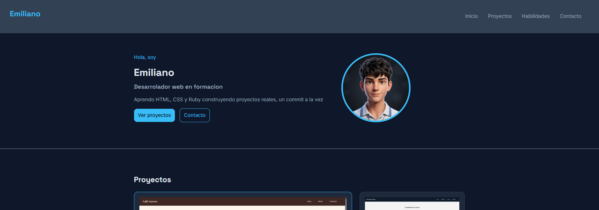

# 💻 My Portfolio

Portafolio personal donde muestro mis proyectos, habilidades y una forma de contactarme. Lo construí desde cero con **HTML** y **CSS**, como parte de mi camino aprendiendo desarrollo web.



## 📌 Secciones

- **Inicio (Hero):** presentación con mi nombre, una breve descripción, botones hacia Proyectos y Contacto, y mi foto con enlace a mi GitHub.
- **Proyectos:** tarjetas con imagen, título, descripción y tecnologías usadas.
  - Café Aurora: landing page de una cafetería (HTML, CSS)
  - Lion Force Gym: landing page de un gimnasio (HTML, CSS, Flexbox)
  - Calculadora: pedidos en terminal con Ruby (próximamente)
  - Portfolio: esta misma página (Grid, Flexbox)
- **Habilidades:** etiquetas con las tecnologías que manejo, cada una con un enlace a su documentación.
- **Contacto:** formulario con nombre, correo y mensaje.
- **Footer:** créditos y enlace a GitHub.

## 🛠️ Tecnologías

- HTML5 semántico (`header`, `nav`, `section`, `article`, `footer`)
- CSS3
  - Variables CSS (`:root`) para colores, fuentes, bordes y ancho máximo
  - CSS Grid para el hero, la galería de proyectos y el formulario
  - Flexbox para el header, el footer y los campos del formulario
  - Media queries para hacerlo responsive
  - Transiciones y efectos `hover`
- Google Fonts: Space Grotesk, Inter y JetBrains Mono

## 📱 Responsive

La página se adapta a distintos tamaños de pantalla:

| Ancho de pantalla | Cambios |
|---|---|
| ≤ 700px | Header y menú más compactos |
| ≤ 550px | Logo más pequeño, formulario en una columna y tarjetas más angostas |
| ≤ 450px | Textos y menú más pequeños para celulares |

## 🎨 Paleta de colores

| Uso | Color |
|---|---|
| Fondo | `#0f172a` |
| Superficie | `#1e293b` |
| Borde | `#334155` |
| Texto | `#e2e8f0` |
| Texto suave | `#94a3b8` |
| Acento | `#38bdf8` |

## 📂 Estructura del proyecto

```
├── index.html
├── style.css
└── img/
    ├── Cafeteria.png
    ├── Lion-force-gym.png
    ├── Portfolio.png
    ├── logo-mio.jpg
    └── negro-fondo.jpg
```

## 🚀 Cómo verlo

1. Clona el repositorio:
   ```bash
   git clone https://github.com/Emife2000/My-Portfile.git
   ```
2. Abre `index.html` en tu navegador.

## 📈 Próximos pasos

- [ ] Terminar el proyecto de la calculadora en Ruby
- [ ] Agregar más proyectos
- [ ] Conectar el formulario de contacto para que envíe mensajes

## 👤 Autor

**Emiliano**: desarrollador web en formación.
GitHub: [@Emife2000](https://github.com/Emife2000)

---

© 2026 Emiliano
